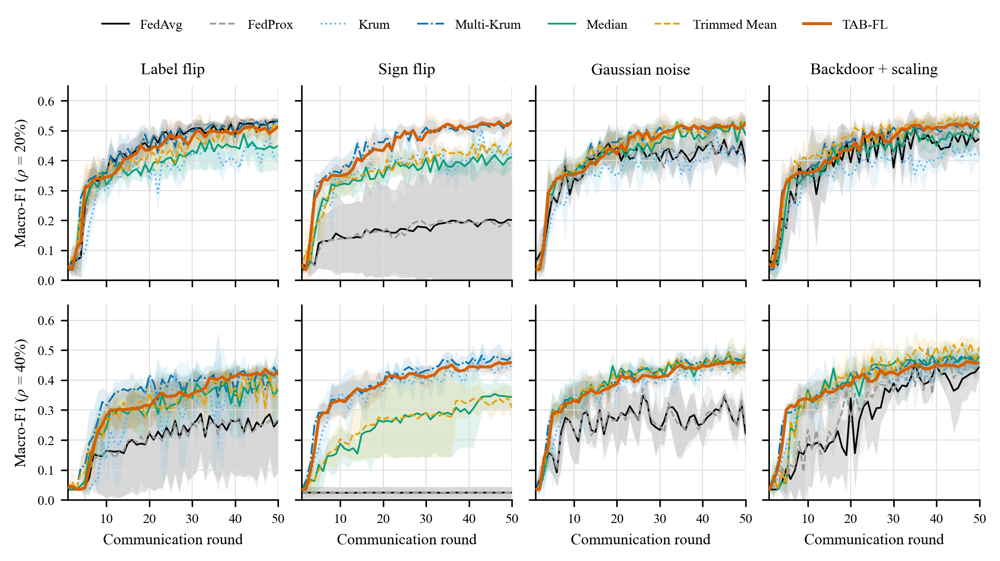
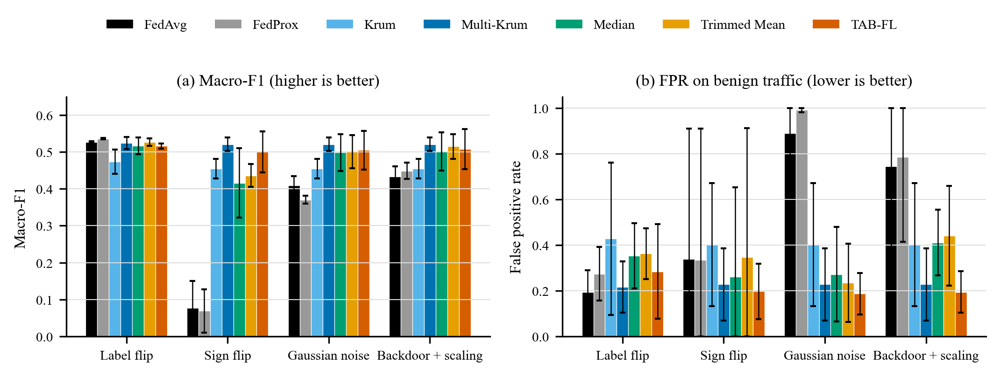

# TAB-FL: Trust-Aware Byzantine-Resilient Federated Learning for Smart-City Intrusion Detection

Code, experiment logs and figures for the paper

> A. Irjoob, G. Rjoub, S. Almobydeen. *Trust-Aware Byzantine-Resilient Federated Learning for
> Real-Time Intrusion and Anomaly Detection in Smart Urban IoT Infrastructures.* Submitted to the
> Springer Nature collection "AI-Driven Smart Cities and Secure Intelligent Infrastructure" (under review).

TAB-FL is a server-side aggregation rule for federated intrusion detection across city edge
gateways (traffic controllers, substation gateways, municipal IoT hubs), some of which may be
compromised. It does not need to know how many gateways are malicious and does not change the
gateways' training.

## How TAB-FL works

Every round, for every gateway update:

1. **Consistency evidence.** Four signals are computed: layer-wise cosine to the median update,
   log norm ratio, loss of the candidate model on a small clean root set held by the server, and
   the largest per-class loss reduction on that root set. Each is turned into a robust z-score
   (median / MAD) over the gateways trusted in the previous round. Deviations within a tolerance
   band of `kappa = 2` cost nothing, so honest but heterogeneous gateways keep an evidence score
   close to 1.
2. **Peer groups (optional).** When the operator knows each gateway's role (e.g. the device type it
   serves), each signal is centred on the median of the gateway's trusted peers of the same role,
   leaving the gateway itself out, and the root-set signals are measured on that role's root
   records. A global guard with a wider band (`kappa_g = 4`) still compares every update with the
   whole population.
3. **Reputation.** Trust is an exponential moving average of the evidence (`alpha = 0.7`).
   Gateways below `max(0.3, 0.6 * median trust)` are quarantined for the round but can earn trust
   back.
4. **Aggregation.** Admitted updates are clipped to `1.5 x` the median norm and averaged with
   trust weights.

## Main results

The study has 820 complete 50-round runs: K = 20 gateways, four attacks, 0-40 % malicious
gateways, 3 seeds for every headline setting. Every number below comes from
`results/experiment_metrics.csv`.

**CICIoT2023, Dirichlet beta = 0.3, 30 % malicious gateways** (Macro-F1 / false-positive rate /
backdoor attack success rate):

| Attack | FedAvg | Median | Multi-Krum (true f) | TAB-FL |
|---|---|---|---|---|
| Sign flip | 0.077 / 0.338 / 0.45 | 0.416 / 0.260 / 0.10 | **0.521** / 0.228 / 0.07 | 0.500 / **0.197** / 0.06 |
| Gaussian noise | 0.410 / 0.890 / 0.04 | 0.498 / 0.272 / 0.07 | **0.521** / 0.228 / 0.07 | 0.505 / **0.187** / 0.05 |
| Backdoor + scaling | 0.433 / 0.746 / 0.98 | 0.502 / 0.411 / 1.00 | **0.521** / 0.228 / 0.07 | 0.508 / **0.195** / **0.06** |

**TON_IoT telemetry, one device type per gateway, 40 % malicious gateways** (Macro-F1):

| Attack | FedAvg | Trimmed mean | Multi-Krum (true f) | TAB-FL w/o peer groups | TAB-FL |
|---|---|---|---|---|---|
| None (0 %) | 0.530 | **0.550** | 0.511 | 0.405 | 0.495 |
| Sign flip | 0.008 | 0.246 | 0.511 | 0.427 | **0.531** |
| Gaussian noise | 0.196 | **0.547** | 0.511 | 0.435 | 0.504 |
| Label flip | 0.384 | 0.412 | **0.485** | 0.346 | 0.460 |

Summary:

- **Where TAB-FL is strong.** It has the lowest false-positive rate on CICIoT2023 under every
  model-poisoning attack. It keeps the backdoor success rate near the clean-model level where the
  median and the trimmed mean let the backdoor through completely. It isolates gateways that turn
  malicious mid-training within a few rounds. It does all this without knowing the number of
  attackers.
- **Where it is not.** Multi-Krum, given the true number of attackers, is 1-2 Macro-F1 points
  ahead on CICIoT2023. TAB-FL does not detect label flipping and degrades under extreme label
  skew (beta = 0.1). On TON_IoT its false-positive rate is higher than Multi-Krum's.
- **Peer groups.** On TON_IoT, peer groups cut the share of honest gateways wrongly quarantined
  from 18.9 % to 3.4 % and raise Macro-F1 by 0.07-0.11 in every scenario.

| Convergence (CICIoT2023) | Robustness across attacks |
|---|---|
|  |  |

## Repository layout

```
code/
  data_loader.py      CICIoT2023 / TON_IoT preprocessing, Dirichlet and device-type partitions, root set
  models.py           1D-CNN + BiGRU detector (16,712 parameters) and a batched multi-client forward pass
  attacks.py          label flip, sign flip, Gaussian noise, backdoor trigger + update boosting
  aggregators.py      FedAvg, FedProx, Krum, Multi-Krum, Median, Trimmed mean, TAB-FL (+ ablations),
                      and FlowerRobustStrategy, which wraps any rule as a Flower strategy
  train_fl.py         experiment runner: single runs, the paper's grid, result collection, Flower check
  generate_plots.py   Figures 2-5 and the LaTeX result tables
  shap_analysis.py    Figure 6 (SHAP expected-gradients attributions)
  efficiency.py       model size, inference latency, communication and aggregation cost
  requirements.txt
data/                 not included; see data/README.md
results/
  runs/               one JSON per run (config, final metrics, per-round curves, trust traces)
  experiment_metrics.csv, round_metrics.csv   all runs merged
  tables/             LaTeX tables used in the paper
  models/             converged TAB-FL models used for the SHAP figure
  efficiency.json, shap_summary.json, flower_equivalence_check.txt
figures/              Figures 1-6 (PDF and PNG); figures/src holds the TikZ source of Figure 1
```

## Installation

Python 3.10:

```bash
git clone https://github.com/gr7-cipher/TAB-FL.git
cd TAB-FL
python -m venv .venv && source .venv/bin/activate
pip install -r code/requirements.txt
```

## Data

The datasets are not redistributed here. Download CICIoT2023 (four merged CSV files) and the
TON_IoT IoT telemetry files, place them as described in [data/README.md](data/README.md), then:

```bash
cd code
python data_loader.py --raw ../data/raw --out ../data/processed
```

## Reproducing the experiments

All commands run from `code/`.

A single run (prints final metrics and the F1 curve):

```bash
python train_fl.py --one --method TAB-FL --attack sign_flip --rho 0.3
python train_fl.py --one --dataset toniot --method TAB-FL --attack gaussian --rho 0.4
```

Methods: `FedAvg`, `FedProx`, `Krum`, `Multi-Krum`, `Median`, `Trimmed Mean`, `TAB-FL`,
`Centralized`, plus the ablations `TAB-FL w/o EMA`, `TAB-FL w/o clipping`,
`TAB-FL w/o validation`, `TAB-FL w/o geometry` and `TAB-FL w/o peer groups`.
Attacks: `none`, `label_flip`, `sign_flip`, `gaussian`, `backdoor`. `--onset 25` starts the attack
at round 25.

The full grid of the paper (820 runs; resumable, one JSON per run in `results/runs/`):

```bash
python train_fl.py --grid all --workers 4      # or: main, dynamic, toniot, ablation, noniid
python train_fl.py --collect                   # writes results/experiment_metrics.csv and round_metrics.csv
python generate_plots.py                       # Figures 2-5 and results/tables/*.tex
python shap_analysis.py                        # Figure 6
python efficiency.py                           # results/efficiency.json
```

The grid took about 14 CPU-hours on an Apple M1. `TABFL_DEVICE=mps` runs local training on an
Apple GPU. `TABFL_DATA` and `TABFL_RUNDIR` override the data and output folders.

Because `results/runs/` is included, `--collect`, `generate_plots.py` and the tables can be
regenerated without re-running any training.

**Hyper-parameter selection.** `TABFL_TUNE=1` replaces the test set with a validation split
carved from the training data. All TAB-FL design choices, including the peer-group variant, were
made in this mode. The test set was not used for tuning.

## Using TAB-FL with Flower

The experiments use a deterministic single-process simulator that trains all 20 gateway models in
one batched program. The same aggregation classes run inside Flower through
`aggregators.FlowerRobustStrategy`:

```python
import aggregators as A

strategy = A.FlowerRobustStrategy(
    aggregator=A.build("TAB-FL"),
    n_clients=20,
    ctx_fn=my_ctx_fn,                  # (server_round, global_flat) -> {"f", "slices", "root_losses", ...}
    initial_parameters=initial_parameters,
)
```

Clients must report `metrics={"cid": <int>}` in their `FitRes` so that trust follows each gateway
across rounds. To check the two paths against each other, run:

```bash
python train_fl.py --check-flower
```

This feeds identical updates to both paths, in shuffled arrival order. The global models agree to
within 1e-7 (`results/flower_equivalence_check.txt`).

## Citation

The paper is under review. Until it is published, please cite this repository:

```bibtex
@misc{irjoob2026tabfl,
  author       = {Irjoob, Ahmad and Rjoub, Gaith and Almobydeen, Shahed},
  title        = {{TAB-FL}: Trust-Aware Byzantine-Resilient Federated Learning for Real-Time
                  Intrusion and Anomaly Detection in Smart Urban {IoT} Infrastructures},
  year         = {2026},
  howpublished = {\url{https://github.com/gr7-cipher/TAB-FL}}
}
```

## Contact

Ahmad Irjoob (corresponding author), Faculty of Artificial Intelligence, Al-Balqa Applied
University, ahmad.irjoob@bau.edu.jo
